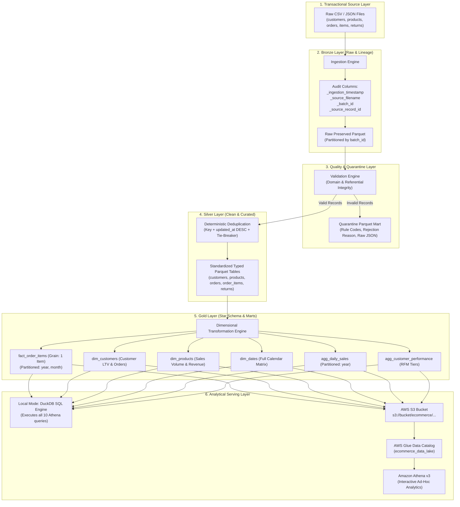

# E-Commerce Data Lake & End-to-End ETL Pipeline

[](https://github.com/vivaangarg2005/E-Commerce-Data-Lake/actions)


-green)


A production-grade, portfolio-quality **E-Commerce Data Lake & Batch ETL Pipeline** implementing the **Medallion Architecture (Bronze -> Silver -> Gold)**.

This project delivers end-to-end data ingestion, lineage tracking, business rule validation, quarantine routing, deterministic deduplication, dimensional modeling (Star Schema), incremental processing, and analytical SQL querying. It features **two strictly separated execution modes**:
1. **Local Mode:** Runs completely offline without cloud credentials or AWS costs, using PySpark, Parquet, and an embedded DuckDB analytical engine.
2. **AWS Mode:** Integrates with real Amazon S3 object storage, AWS Glue Data Catalog, and Amazon Athena with exponential-backoff retries and validation.

---

## Architecture Overview



---

## Core Technologies & Responsibilities

| Technology | Responsibility in Pipeline |
| :--- | :--- |
| **Python 3.10+** | Core scripting, pipeline orchestration, CLI runners, and configuration management. |
| **Apache Spark / PySpark** | Distributed DataFrame processing, data validation, deduplication, and Star Schema construction. |
| **Apache Parquet (Snappy)** | Columnar analytical storage format, partitioned by `(year, month)` and `(year)` to optimize file size and scan costs. |
| **DuckDB** | High-performance in-process SQL OLAP engine executing Athena-compatible queries against local Parquet files. |
| **Amazon S3 (`boto3`)** | Cloud object storage for Bronze, Silver, Gold, Quarantine, and Audit artifacts with retry backoff. |
| **AWS Glue Data Catalog** | External database and table metadata registry for Parquet tables and partition definitions. |
| **Amazon Athena (v3)** | Serverless interactive SQL query engine querying curated S3 datasets. |
| **Pytest** | Automated unit, integration, invariant reconciliation, and AWS mock test suite. |
| **Ruff** | Code formatting and linting enforcing PEP 8 standards. |

---

## Dataset & Provenance

The project includes a **deterministic synthetic e-commerce generator** (`SyntheticDataGenerator`) with fixed random seeds (`seed=42`) ensuring **100% reproducible execution**:
- **Provenance:** Fully synthetic data generated locally to simulate realistic transactional patterns without exposing PII.
- **Profiles:** Configurable dataset sizes:
  - `dev`: 100 customers, 25 products, 250 orders (~1,000 order items).
  - `standard`: 1,000 customers, 100 products, 3,000 orders (~10,000 order items).
  - `large`: 10,000 customers, 500 products, 25,000 orders (~85,000 order items).
- **Relational Integrity:** Orders reference valid customers; order items reference valid orders and products; returns reference valid delivered order items.
- **Anomalies Injected for Testing:** Includes a controlled 2–3% anomaly rate (negative quantities, invalid emails, discounts exceeding gross price, orphan foreign keys) to verify that the validation engine routes every invalid row to quarantine.

---

## Data Model & Schemas

### Medallion Architecture Flow
1. **Bronze (`data/bronze/`):** Raw ingested CSV/JSON data with attached lineage metadata (`_ingestion_timestamp`, `_source_filename`, `_batch_id`, `_source_record_id`).
2. **Silver (`data/silver/`):** Validated, typed, cleaned, and deterministically deduplicated tables:
   - `customers`, `products`, `orders`, `order_items`, `returns`.
3. **Gold (`data/gold/`):** Dimensional model (Star Schema) and analytical data marts:
   - **`fact_order_items`:** Grain: strictly 1 row per order item. Partitioned by `year` and `month`. Contains line item gross, discounts, net amount, return flags, and cancellation status.
   - **`dim_customers`:** Grain: 1 row per customer. Enriched with lifetime orders, lifetime net spend, first/last purchase dates.
   - **`dim_products`:** Grain: 1 row per product. Enriched with total units sold and revenue.
   - **`dim_dates`:** Full calendar matrix (date key, year, quarter, month, day, day of week, weekend flag).
   - **`agg_daily_sales`:** Grain: `order_date`, `category`. Partitioned by `year`.
   - **`agg_customer_performance`:** Customer RFM segmentation (`VIP`, `REGULAR`, `OCCASIONAL`).

---

## Repository Structure

```
E-Commerce-Data-Lake/
├── README.md                           # Master documentation
├── pyproject.toml                      # Build metadata, ruff, and pytest config
├── requirements.txt                    # Pinned core dependencies
├── .gitignore                          # Excludes credentials, data, and cache
├── .env.example                        # Example environment variables
├── config/
│   ├── config.yaml                     # Active pipeline configuration
│   └── config.example.yaml             # Example configuration
├── src/
│   └── ecommerce_data_lake/
│       ├── __init__.py
│       ├── config.py                   # Type-safe configuration loader
│       ├── logging_config.py           # Structured JSON and console logging
│       ├── schemas.py                  # PySpark StructTypes & domain enums
│       ├── data_generation.py          # Deterministic synthetic data generator
│       ├── ingestion.py                # Bronze layer ingestion & lineage
│       ├── validation.py               # Business rules, integrity & quarantine
│       ├── deduplication.py            # Deterministic tie-breaker deduplication
│       ├── transformations.py          # Silver typing & Gold Star Schema transforms
│       ├── storage.py                  # Spark session factory & Parquet I/O
│       ├── incremental.py              # Manifest state manager & watermark tracking
│       ├── analytics.py                # DuckDB local Athena-compatible SQL runner
│       ├── aws_s3.py                   # Boto3 S3 client with backoff retries
│       ├── glue_catalog.py             # Glue Data Catalog external table manager
│       └── pipeline.py                 # End-to-end Pipeline orchestrator
├── sql/
│   ├── create_tables.sql               # Amazon Athena external table DDL
│   └── analytics/                      # 10 Athena analytical SQL queries
│       ├── 01_monthly_revenue.sql
│       ├── 02_revenue_by_category.sql
│       ├── 03_top_products.sql
│       ├── 04_daily_sales_trends.sql
│       ├── 05_customer_frequency.sql
│       ├── 06_customer_lifetime_value.sql
│       ├── 07_order_status_distribution.sql
│       ├── 08_returns_and_refunds.sql
│       ├── 09_data_quality_exceptions.sql
│       └── 10_cross_table_integrity.sql
├── scripts/
│   ├── generate_data.py                # CLI dataset generator
│   ├── run_local.py                    # CLI local pipeline & SQL runner
│   ├── run_aws.py                      # CLI AWS integrated pipeline runner
│   └── setup_winutils.py               # Windows Hadoop binaries setup
├── tests/
│   ├── conftest.py                     # Pytest fixtures (Spark session, temp dirs)
│   ├── unit/
│   │   ├── test_schemas.py
│   │   ├── test_validation.py
│   │   ├── test_deduplication.py
│   │   ├── test_transformations.py
│   │   ├── test_incremental.py
│   │   └── test_analytics.py
│   ├── integration/
│   │   ├── test_pipeline_local.py
│   │   └── test_data_quality_invariants.py
│   └── aws/
│       ├── test_aws_s3.py
│       └── test_glue_catalog.py
├── docs/
│   ├── architecture.md                 # Deep-dive architecture and data flow
│   ├── data_dictionary.md              # Detailed data dictionary
│   ├── aws_setup.md                    # AWS IAM, S3, Glue, and Athena setup
│   ├── troubleshooting.md              # Common issues and solutions
│   └── design_decisions.md             # Key engineering decisions & trade-offs
└── .github/
    └── workflows/
        └── ci.yml                      # GitHub Actions automated CI workflow
```

---

## Local Development & Setup

### 1. Prerequisites
- Python 3.10, 3.11, 3.12, or 3.13.
- Java (JRE/JDK 11, 17, or 21) installed for Apache Spark.
- *(Windows only)* Hadoop winutils (automatically configured via script below).

### 2. Installation
Clone the repository and install dependencies:
```bash
git clone https://github.com/vivaangarg2005/E-Commerce-Data-Lake.git
cd E-Commerce-Data-Lake

# Create and activate virtual environment (optional but recommended)
python -m venv venv
# On Windows: venv\Scripts\activate | On Unix: source venv/bin/activate

# Install dependencies
pip install -r requirements.txt
```

*(Windows users only)* If running on Windows, execute the one-line Hadoop setup helper:
```bash
python scripts/setup_winutils.py
```

### 3. Running the Local Pipeline
Run the complete pipeline end-to-end (ingests raw data, creates Bronze, validates, creates Silver, builds Gold Star Schema, and runs all 10 SQL queries):
```bash
python scripts/run_local.py --batch batch_001 --profile dev
```

### Measured Local Pipeline Output:
```
================================================================================
PIPELINE EXECUTION SUMMARY: run_20261011_160118_35c185
================================================================================
Status:               SUCCESS_WITH_WARNINGS
Batch ID:             batch_001
Data Quality Score:   99.63%
Total Rows Ingested:  1,087
Silver Curated Rows:  1,071
Quarantined Rows:     4
Duplicates Removed:   12

Gold Analytical Datasets Created:
  * fact_order_items         :    651 rows (Partitioned: year, month)
  * dim_customers            :    100 rows
  * dim_products             :     25 rows
  * dim_dates                :    731 rows
  * agg_daily_sales          :    439 rows (Partitioned: year)
  * agg_customer_performance :     90 rows
================================================================================
```

---

## Analytical SQL Queries (Athena & DuckDB)

The project includes **10 production analytical queries** located in `sql/analytics/`. These queries run directly in Amazon Athena on AWS or locally via DuckDB:

1. `01_monthly_revenue.sql`: Total distinct orders, units sold, gross sales, discounts, and net revenue by year and month.
2. `02_revenue_by_category.sql`: Category revenue rankings, average item prices, and effective price per unit.
3. `03_top_products.sql`: Top 10 revenue-generating products with dense rank.
4. `04_daily_sales_trends.sql`: Daily sales trends tracking order counts, net revenue, and refunds.
5. `05_customer_frequency.sql`: Segmentation into One-Time (1 order), Repeat (2-4), Loyal (5-9), and Power Buyers (10+).
6. `06_customer_lifetime_value.sql`: Top customers by lifetime spend with tier classifications.
7. `07_order_status_distribution.sql`: Order status percentages (Delivered, Shipped, Processing, Cancelled).
8. `08_returns_and_refunds.sql`: Product return rates and refund amounts by merchandise category.
9. `09_data_quality_exceptions.sql`: Breakdown of quarantined records by entity and rule violation code.
10. `10_cross_table_integrity.sql`: **Cross-table financial reconciliation verifying that Fact net sales exactly equals Customer Dimension net sales and Daily Aggregate net sales down to the cent.**

### Actual Measured Query 10 Output:
```json
{
  "fact_net_sales": 526234.02,
  "dim_cust_net_sales": 526234.02,
  "agg_net_sales": 526234.02,
  "fact_vs_cust_discrepancy": 0.00,
  "fact_vs_daily_discrepancy": 0.00,
  "reconciliation_status": "RECONCILED"
}
```

---

## Incremental Processing Contract

The incremental coordinator (`IncrementalStateManager`) ensures reliable batch execution:
1. **Manifest Tracking:** State recorded in `data/state/pipeline_manifest.json` with batch status (`IN_PROGRESS`, `COMMITTED`, `FAILED`), row counts, and UTC watermarks.
2. **Idempotent Reruns:** Resubmitting an existing batch does not duplicate records. It updates existing records deterministically by business key.
3. **Failure Isolation:** If a stage fails, the batch is marked `FAILED` and the high-watermark is **never advanced**, ensuring safe retries.

---

## AWS Integration Mode

When configured with AWS credentials and S3 bucket, run:
```bash
export PIPELINE_ENV=aws
export AWS_S3_BUCKET=my-ecommerce-data-lake-bucket
export AWS_REGION=us-east-1

python scripts/run_aws.py --batch batch_001
```

- **S3 Bucket Layout:**
  - `s3://BUCKET/ecommerce/bronze/`
  - `s3://BUCKET/ecommerce/silver/`
  - `s3://BUCKET/ecommerce/gold/`
  - `s3://BUCKET/ecommerce/quarantine/`
  - `s3://BUCKET/ecommerce/audit/`
- **Glue Data Catalog:** Automatically creates database `ecommerce_data_lake` and registers all external Parquet tables.
- **Fail-Fast Safety:** AWS mode verifies S3 access and IAM permissions upfront; it never simulates cloud success if credentials are missing.

---

## Automated Test Suite

Run the full pytest suite:
```bash
# Run unit and AWS tests
python -m pytest tests/unit tests/aws -v

# Run full integration tests
python -m pytest tests/integration -v
```

### Covered Test Areas:
- Schema contracts and domain enum validations.
- Validation engine: malformed email, negative quantities, orphan foreign keys, excessive discounts.
- Deterministic deduplication with update timestamps and tie-breakers.
- Financial arithmetic and grain fan-out prevention.
- Incremental state transitions, failure recovery, and watermark freezes.
- DuckDB Parquet querying.
- Full local end-to-end pipeline execution and idempotent batch rerun.
- Cross-table financial and referential integrity invariants.

---

## Code Quality & CI

Automated checks run on every commit via GitHub Actions (`.github/workflows/ci.yml`):
```bash
# Check formatting and linting
ruff check src/ scripts/ tests/
```

---

## License

This project is licensed under the MIT License.
