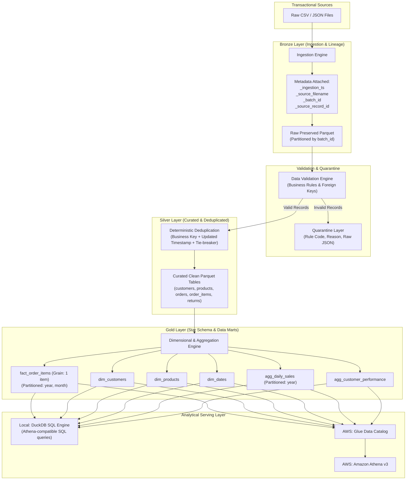

# E-Commerce Data Lake & ETL Architecture

## 1. Overview
This project implements a multi-layer Medallion Architecture (Bronze -> Silver -> Gold) designed for an end-to-end e-commerce data platform. It operates under two distinct, uncoupled modes:
1. **Local Mode:** Self-contained execution on developer laptops using Apache PySpark, Parquet columnar storage, and DuckDB SQL query engine without requiring cloud credentials or incurring cloud costs.
2. **AWS Mode:** Cloud execution synchronizing curated Parquet datasets to Amazon S3, registering external tables and partitions in the AWS Glue Data Catalog, and querying via Amazon Athena v3.

---

## 2. Logical Data Flow Diagram

---

## 3. Layer Specifications

### Bronze Layer (Raw Ingestion)
- **Objective:** Ingest source files without destructive mutation.
- **Enrichment:** Attaches four mandatory audit lineage columns:
  - `_ingestion_timestamp`: UTC timestamp of the ingestion run.
  - `_source_filename`: Exact name of the input file.
  - `_batch_id`: Processing batch identifier.
  - `_source_record_id`: Unique identifier tracking the record across transformations.
- **Partitioning:** Partitioned by `batch_id`.

### Validation & Quarantine Layer
- Evaluates records against explicit domain rules and referential integrity relationships.
- Separates rejected records into `data/quarantine` containing:
  - `quarantine_id`, `entity_name`, `source_record_id`, `batch_id`, `source_filename`, `rejection_stage`, `rule_code`, `rejection_reason`, `raw_record_json`, `quarantine_timestamp`.
- Allows auditability and root-cause debugging without stopping pipeline execution.

### Silver Layer (Cleaning & Deduplication)
- **Type Conversions:** Strongly typed columns (`DateType`, `TimestampType`, `DecimalType(10,2)`, `IntegerType`).
- **Standardization:** Trims whitespace, lowercases emails, standardizes uppercase status codes.
- **Deduplication:** Business key grouping ordered by `updated_at DESC` with stable tie-breaker `_source_record_id DESC`. Idempotent across multiple runs.

### Gold Layer (Analytics-Ready Marts)
- **`fact_order_items`:** Star schema fact table. Strictly 1 row per order item. Joins order header, customer key, product key, and return status without join fan-out. Partitioned by `year` and `month`.
- **`dim_customers`:** Enriched customer profile with lifetime order count, lifetime net spend, first/last purchase dates.
- **`dim_products`:** Catalog attributes with cumulative sales volume and gross revenue.
- **`dim_dates`:** Full calendar dimension (quarter, month name, day of week, weekend indicator).
- **`agg_daily_sales`:** Fast analytical aggregate table partitioned by `year`.
- **`agg_customer_performance`:** Customer segmentation (VIP, REGULAR, OCCASIONAL tiers).
